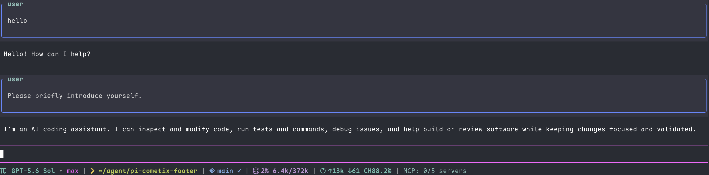

# pi-cometix-footer

[](https://www.npmjs.com/package/pi-cometix-footer)
[](./LICENSE)
[](https://pi.dev)

Single-line **cometix-style** footer for [pi](https://pi.dev) — model, path, git, context window, session tokens, latest-response throughput, cost, and task time at a glance.

Look inspired by [CCometixLine](https://github.com/Haleclipse/CCometixLine) (MIT). Independent pi extension; own codebase.

---

## Preview



```text
π  GPT-5.6 Sol • max  |  > ~/agent/pi-cometix-footer  |  main ✓  |  2% 6.4k/372k  |  ↑13k ↓61 CH88.2%  |  󰄉 1m 23s · 42.3 tok/s  |  󰇁 0.284  |  MCP: 0/5 servers
```

| Segment | What it shows | Color |
| --- | --- | --- |
| **Model** | Model name + thinking level (`• high`) | cyan · level uses pi palette |
| **Directory** | CWD, `~`-relative | yellow icon / green path |
| **Git** | Branch · clean `✓` / dirty `●` / conflict `⚠` · ahead `↑n` / behind `↓n` | blue |
| **Context** | Window fill `pct tokens/window` | magenta → yellow (>70%) → red (>90%) |
| **Tokens** | Session `↑in ↓out` + latest cache hit `CH%` | cyan |
| **Cost** | Session cumulative USD cost reported by Pi (`󰇁 0.000`); omitted when zero/unavailable | yellow |
| **Activity** | Live task time (updated every second) + optional latest-response TPS; final values remain after the agent settles | magenta |
| **Statuses** | Extension / MCP status lines (if any) | theme default |

Segments are bold, separated by dim ` | `, with Nerd Font icons (emoji fallback available).

---

## Install

```bash
pi install npm:pi-cometix-footer
```

Or from git:

```bash
pi install git:github.com/Xichun123/pi-cometix-footer
```

Then in pi:

```text
/reload
```

The footer is active while the extension is installed. Open its settings with the single command:

```text
/cometix-footer
```

Segment visibility, order, and generation speed (TPS) are all configured in this menu. There is no whole-footer off switch or subcommand. To remove the footer, uninstall the package with `pi remove <installed-source>` and run `/reload`.

Session totals include all billable usage in the session file: assistant responses, nested model work reported by tools, cache warming, compaction, and branch summaries. Cache hit rate belongs only to the latest assistant response; unknown prompt usage hides it rather than keeping a stale value.

TPS uses the final output-token count divided by the elapsed time from the first streamed output delta to response completion, so time to first token is excluded. It is omitted when a provider does not stream output deltas or report valid output-token usage.

> **Migrating from a loose file?**  
> If you previously copied `cometix-footer.ts` into `~/.pi/agent/extensions/`, remove that file first to avoid loading the footer twice.

---

## Customize

### Choose segments and their order

```text
/cometix-footer
```

The settings panel stays open while you edit, and keeps the arrow on the item you changed:

- **↑ / ↓**: select an element.
- **Enter / Space**: show/hide it (`✓` enabled, `○` hidden), or toggle **生成速度（TPS）**.
- **- / +**: move the selected element up/down; the arrow follows it. No Ctrl needed, avoiding system/terminal shortcut conflicts.
- Select **恢复默认** and press Enter to reset the draft.
- **Ctrl+S**: save, apply immediately, and close the panel. No separate save menu item.
- **Esc**: discard changes and close.

The eight elements are model/thinking level, directory, Git, context, tokens/cache hit, task time/TPS, cost, and extension/MCP statuses. Hidden elements keep their place when re-enabled. Missing data (such as Git outside a repository) still omits that element without leaving extra separators. The **生成速度（TPS）** menu option controls speed within the task-time element; hiding that element hides both time and speed.

Layout preferences are saved globally in `~/.pi/agent/cometix-footer.json` (or under `PI_CODING_AGENT_DIR`), and loaded on startup/reload. Invalid files produce a warning and use defaults without overwriting the file. Disabling Git stops its polling and branch subscription; disabling task time stops its live ticker. Older configuration files without a TPS setting keep TPS enabled by default.

### Colors and icons

For these advanced options, edit the installed package (or a local clone), then `/reload`.

| Knob | Where | Purpose |
| --- | --- | --- |
| `ICON_MODE` | top of `index.ts` | `"nerd"` (default) or `"emoji"` if no Nerd Font |
| `ICONS.nerd.*` | icon map | per-segment Nerd Font codepoints |
| `C.*` | color map | 16-color SGR codes per segment |
| `GIT_TTL` | near git cache | git status refresh interval (ms, default `3000`) |

Nerd Font cheatsheet: <https://www.nerdfonts.com/cheat-sheet>

Local install for hacking:

```bash
git clone https://github.com/Xichun123/pi-cometix-footer.git
pi install ./pi-cometix-footer
```

---

## Requirements

- Node.js **22.19.0 or newer**
- [pi](https://pi.dev): tested baseline **0.99.1**; CI also checks the latest npm release. Older releases are not supported.
- Host-provided peers: `@earendil-works/pi-coding-agent`, `@earendil-works/pi-tui`. The `*` peer ranges follow Pi packaging conventions; they do not promise compatibility with every version.
- A [Nerd Font](https://www.nerdfonts.com/) in your terminal — or set `ICON_MODE = "emoji"`

---

## Development and compatibility checks

```bash
npm ci --ignore-scripts
npm run check
npm pack --dry-run
```

`check` runs strict TypeScript checking and Node's built-in tests, including real Pi extension loading, usage aggregation, streaming events, rendering, resource cleanup, and stale Git-query cancellation. Development dependencies are pinned in `package-lock.json`; no runtime dependencies are bundled with the extension.

Compatibility CI runs on pushes, pull requests, and weekly: Node 22.19.0 with Pi 0.99.1, and Node 24 with the latest Pi release. Release tags run the same type/test checks before publishing with a pinned npm CLI.

### npm publishing setup

On npmjs.com, configure this package's Trusted Publisher for user `Xichun123`, repository `pi-cometix-footer`, and workflow filename `publish.yml` (not its full path). Allow direct `npm publish`; a stage-only authorization will not work with this workflow. This account-side configuration cannot be set or verified by the repository tests. GitHub Actions uses a GitHub-hosted runner and `id-token: write`; no publishing token is needed.

---

## Credits

- Visual language borrowed from [CCometixLine](https://github.com/Haleclipse/CCometixLine) by Haleclipse (MIT)
- Built as a [pi](https://pi.dev) extension package

## License

[MIT](./LICENSE) © Xichun123
